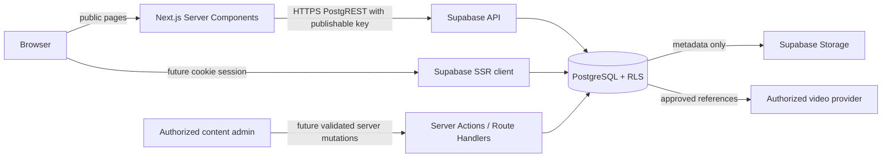

# CINEVA database architecture

## Current state and implementation boundary

The project began with local TypeScript catalogues (`src/data/movies.ts` and `src/data/series.ts`) and one client component, `src/components/Studio.tsx`, rendering the existing routes. No Supabase client, authentication, API, database, or environment configuration was present at inspection. The local catalogue has 3 movies, 2 movie parts, 1 series, 1 season, and 1 episode. See `DATABASE_MIGRATION.md` for source-level detail.

This change adds versioned schema/security SQL, a dry-run-first idempotent catalogue importer, and a server-side public catalogue adapter. Existing routes and Studio UI remain in place. Without a Supabase project URL/key, the adapter uses the original TypeScript arrays. When configured, it reads published catalogue records from Supabase. Imported content is intentionally draft and every media source is inactive pending review.

The schema is designed for PostgreSQL/Supabase. **Neither migration has been applied to a database.** Supabase CLI/PostgreSQL tooling and project credentials were unavailable in this workspace, so SQL execution, RLS behavior, auth, Storage, and live catalogue reads remain unverified. The Supabase SDK could not be fetched in this environment, so cookie-backed Supabase Auth integration is not included; no pretend or insecure substitute is used.

## Recommended flow

Public reads run in Server Components through `src/lib/data/catalogue.ts`. Sensitive mutations should use authenticated Server Actions and narrow Route Handlers for webhooks. A repository layer should own SQL/API mapping as write features are added. Never put a Supabase secret/service-role key into browser code or a `NEXT_PUBLIC_*` variable.

## Schema inventory

The two migrations define 39 application tables: `content_items`, `movies`, `series`, `movie_parts`, `seasons`, `episodes`, `categories`, `genres`, `movie_genres`, `series_genres`, `media_assets`, `media_sources`, `external_links`, `profiles`, `user_preferences`, `roles`, `permissions`, `user_roles`, `role_permissions`, `favorites`, `watchlists`, `watchlist_items`, `watch_history`, `user_ratings`, `reviews`, `comments`, `reports`, `conversations`, `conversation_participants`, `messages`, `message_attachments`, `message_read_receipts`, `message_blocks`, `message_reports`, `announcements`, `notification_preferences`, `notifications`, `moderation_actions`, and `admin_audit_log`.

| Table | Main data / purpose |
|---|---|
| `content_items` | UUID, type, legacy numeric ID, slug, shared title/description/year/language/artwork/status/timestamps |
| `movies` | 1:1 movie subtype; nullable source rating, category FK, source views label |
| `series` | 1:1 series subtype; source views label |
| `movie_parts` | UUID, movie FK, source child ID, positive part number/title |
| `seasons` | UUID, series FK, source child ID, positive season number/title |
| `episodes` | UUID, season FK, source child ID, positive episode number, title/description/quality/duration/status/thumbnail |
| `categories` | UUID, unique name and slug, optional description |
| `genres` | UUID, unique name and slug |
| `movie_genres` | Movie/genre junction with composite PK |
| `series_genres` | Series/genre junction with composite PK |
| `media_assets` | Artwork/attachment metadata, storage provider/bucket/object key, MIME/size/dimensions, creator |
| `media_sources` | Exactly one part/episode FK; source kind/provider/reference/language/quality/active/public/order/creator |
| `external_links` | Content FK, link kind/label/URL/active/order |
| `profiles` | Auth user UUID PK, display name, profile asset, status, registration/update timestamps |
| `user_preferences` | User PK/FK, language/theme, update timestamp |
| `roles` | Identity key, user/moderator/administrator name, description |
| `permissions` | Identity key, unique permission name and description |
| `user_roles` | User/role junction, grantor and grant timestamp |
| `role_permissions` | Role/permission junction |
| `favorites` | User/content composite PK and creation timestamp |
| `watchlists` | UUID, owner, unique owner/name, default marker and timestamps |
| `watchlist_items` | Watchlist/content composite PK and added timestamp |
| `watch_history` | User plus exactly one part/episode, position/duration/completion/last-watched |
| `user_ratings` | UUID, user/content, 1–5 integer rating and timestamps; unique owner/content |
| `reviews` | UUID, user/content, optional title, body, moderation status, soft-delete and timestamps |
| `comments` | UUID, user/content, optional parent comment, body, moderation status, soft-delete and timestamps |
| `reports` | Reporter, exactly one content/review/comment target, reason/details/status/assignee/timestamps |
| `conversations` | Direct/group type, canonical direct pair, creator/timestamps/closed time |
| `conversation_participants` | Conversation/user composite PK, joined and optional left timestamp |
| `messages` | Conversation/sender, body, created/edited/deleted timestamps, moderation status |
| `message_attachments` | Message/media-asset junction with uniqueness and timestamp |
| `message_read_receipts` | Message/user composite PK and read timestamp |
| `message_blocks` | Blocker/blocked composite PK; self-block rejected |
| `message_reports` | Reporter/message, reason/details/status/assignee/timestamps |
| `announcements` | Title/body/status/creator/publication and audit timestamps |
| `notification_preferences` | User/type composite PK, in-app/email toggles |
| `notifications` | Recipient, type/title/message, optional typed content target/action/read timestamp/dedup key |
| `moderation_actions` | Actor, exactly one moderated target, action/reason/time |
| `admin_audit_log` | Actor/action/entity UUID, before/after JSON, request ID and timestamp |

Exact PostgreSQL types, nullability, FK deletion rules, checks, indexes, triggers and RLS grants/policies are defined in the migration SQL; these files are the executable schema source of truth.

Catalog records use UUID primary keys and retain source numeric IDs in `content_items.legacy_id` with uniqueness scoped by `content_type`. Movies and series have one-to-one subtype rows keyed by the same content UUID. A deferred constraint trigger verifies subtype correctness at transaction commit, while an insert trigger provisions the subtype. Parts, seasons, and episodes are relational children; media sources attach to exactly one part or episode using a check constraint. Artwork metadata is shared through `media_assets`; movie parts inherit parent artwork, while episodes may reference an optional thumbnail and otherwise inherit series artwork in the UI/data mapping.

All content uses `draft`, `published`, or `archived`; `published_at` is maintained on publication. Existing `createdAt` calendar dates are preserved separately as `legacy_created_date`, not misrepresented as exact timestamps. Ratings from the catalogue remain nullable. User ratings currently use an explicitly chosen default integer scale of 1–5; change its check constraint through a later migration if product owners choose another scale.

See `DATABASE_RELATIONSHIPS.md` for the Mermaid ER diagram and key constraints, and `DATABASE_SECURITY.md` for grants/RLS behavior.

## Important operational choices

- Only published content and explicitly active, public media sources are readable anonymously. Import-created sources default to inactive and non-public.
- The `media_sources.external_reference` field can contain provider URLs. Audit snapshots deliberately omit this field. Keep signed credentials out of source URLs; issue short-lived signed URLs server-side if the provider requires them.
- `legacy_local` artwork references preserve existing paths; importer reports missing local image files and does not upload or fabricate replacements.
- A direct conversation is represented by a canonical sorted participant pair plus two participant rows. The RPC is the only initial creation path. Message moderation access is report-scoped via a privileged function and writes an audit event; no blanket administrator conversation-read policy is installed.
- Content admins and user admins require named permissions assigned through protected functions. The seeded administrator role receives all seeded permissions; the moderator role receives report and comment moderation only.
- Reviews/comments begin pending. Moderation uses explicit statuses and a `moderation_actions` history. Audit records are trigger-written and ordinary clients have read-only access subject to `audit.read`.
- Public catalogue data can be cached later, but authenticated/personal data must not be shared through public caches.

## Local files introduced

- `supabase/migrations/20261108000100_initial_schema.sql`: relational schema, constraints, indexes, timestamps, storage buckets and subtype integrity.
- `supabase/migrations/20261108000200_security_and_operations.sql`: auth profile provisioning, RLS, grants, RPCs, notification/audit triggers and Storage policies.
- `supabase/config.toml`: local Supabase CLI defaults; not validated by a local Supabase stack.
- `scripts/import-catalogue.mjs`: deterministic-UUID, repeatable importer; default is report-only, `--apply` writes.
- `scripts/verify-catalogue-parity.mjs`: read-only parity verifier that suppresses URL values and secrets.
- `src/lib/data/catalogue.ts`: server-side published catalogue reader with static fallback only when both public Supabase settings are absent.
- `.env.example`, `.gitignore`: placeholder configuration and local secret/artifact ignores.

## Next steps before production use

1. Review and apply migrations to a disposable Supabase project with the Supabase CLI; resolve any platform-specific SQL issues before a production database.
2. Run schema/RLS tests with separate anonymous, user A, user B, moderator, and administrator identities; the static SQL has not had a PostgreSQL parser/runtime check here.
3. Review catalogue parity output, upload/replace artwork only through an authorized process, and explicitly approve media sources before publication.
4. Install the currently supported Supabase SSR packages through the project’s approved package workflow; implement cookie session refresh, login/logout, and server authorization.
5. Generate `src/types/database.types.ts` from the applied schema and use it for the database client/repositories.
6. Add transactional, validated mutations for favorites, watchlists, progress, messaging, notifications, administration, and moderation. These tables and policies are foundations; UI/API features are not implemented by this phase.
7. Run the full database test matrix, backup/restore rehearsal, build, and security review before production.
