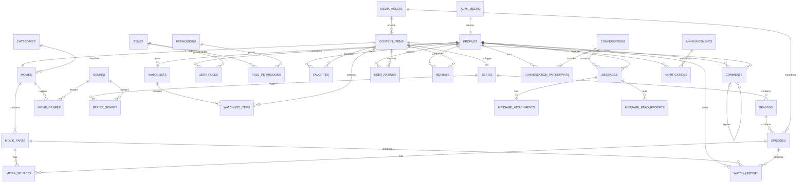

# CINEVA database relationships

`content_items` is the shared content parent. Its `(content_type, legacy_id)` and `(content_type, slug)` are unique, allowing numeric legacy IDs and slugs to overlap between movie and series types while remaining unique within type. Deferred integrity enforces exactly one matching `movies` or `series` subtype. UUIDs are internal identifiers; legacy IDs remain available to source data and application links.

`movie_parts` belongs to one movie subtype; `seasons` belongs to one series subtype; `episodes` belongs to one season. Each child number is positive and unique per parent. `media_sources` has a check requiring exactly one of `movie_part_id` or `episode_id`; source kind is trailer, playback, or download. A media asset is stored once and may be referenced by content artwork or episode thumbnail. Movie-part artwork is inherited from its parent instead of duplicated.

Favorites and watchlist items have composite primary keys to reject duplicates. Watch history has two partial unique indexes, one per user/movie-part and user/episode. User rating is unique per user/content. `watch_history` has a check requiring exactly one playable target. Direct conversations use a unique canonical user pair; the creation RPC atomically inserts both participant rows. Read receipts use `(message_id,user_id)` primary keys. Current group type exists structurally, but the RPC intentionally only creates direct conversations.

Deletion behavior is explicit in foreign keys: catalogue child rows cascade with their parent; genre references restrict deletion until mappings are removed; user-owned activity cascades on account deletion; optional moderation actors/asset pointers generally set null; private messages and related attachment metadata cascade with conversation/message deletion. Object-storage deletion is not transactional with PostgreSQL and requires a cleanup job before hard deletion. Account closure is the safer default; permanent deletion requires a separately reviewed retention policy.

Indexes target public content ordering/search, parent-child ordering, genre lookup, personal lists/history, message timeline/participant lookup, unread notifications, reports, and audit review. Verify index plans with realistic data before adding more indexes.
